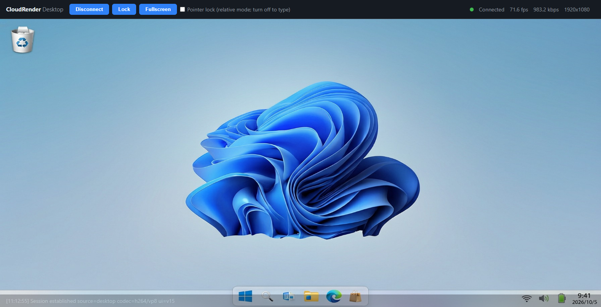

# CloudRender Desktop

**English** | [中文](#中文)

## English

A **WebRTC**-based cloud desktop: the C++ server captures the OS desktop or a window and streams it to a browser, while keyboard/mouse input is sent back — "operate locally, render in the cloud". Any application works without modification.

CloudRender now ships a single server edition: the **C++ server on port 8081**. The media core is C++; a lightweight signaling shell hosts the built-in Web UI and bridges JSON signaling. The standalone release package bundles the runtime, so the target machine needs neither Python nor a C++ toolchain.

## Highlights

- **Universal capture**: the render source is the OS desktop/window (DXGI Desktop Duplication, zero-copy); no application changes required;
- **C++ media core**: `cloudrender_session.dll` (libwebrtc) plus nativecore for capture and SendInput injection;
- **Built-in Web UI**: the page and `/ws` share one port/origin — open `http://<ip>:8081/` and connect;
- **Zero-install client**: browser-native WebRTC; keyboard/mouse/wheel/touch/gamepad are captured by the JavaScript SDK;
- **Token gate**: the server and page default to `123456`; a wrong token returns code 4001 and stops auto-reconnect;
- **Standalone release**: no Python or Visual C++ toolchain is required on the target machine.

## Capability matrix

| Module | Language | WebRTC backend | Capture/inject | Directory |
|---|---|---|---|---|
| Native core nativecore | C++ | - | DXGI capture + SendInput injection, C ABI | [server/cpp/nativecore](server/cpp/nativecore) |
| Server (C++ edition, 8081) | C++ core + signaling shell | libwebrtc (`cloudrender_session.dll`) | nativecore direct link (via C ABI) | [server/cpp/shell](server/cpp/shell) |
| Server SDK (C++) | C++ | libwebrtc | links nativecore directly | [server/cpp/sdk](server/cpp/sdk) |
| Client SDK | JavaScript | browser-native WebRTC | keyboard/mouse/wheel/touch/gamepad capture | [client/javascript](client/javascript) |

## Architecture

```
┌──────────────────────────────────────────────────────┐
│ Browser: JavaScript SDK + built-in Web UI            │
└───────────────┬──────────────────────────────────────┘
                │ WebRTC: video/audio + DataChannel input
┌───────────────▼──────────────────────────────────────┐
│ C++ server (8081)                                    │
│ signaling shell + Web UI hosting                     │
│         │ ctypes                                     │
│ ┌───────▼──────────────────────────────────────────┐ │
│ │ cloudrender_session.dll (libwebrtc)              │ │
│ │  └─ nativecore: DXGI capture + SendInput         │ │
│ └──────────────────────────────────────────────────┘ │
└──────────────────────────────────────────────────────┘
```

The page and the WebSocket endpoint share the same port and origin; only one inbound TCP port has to be allowed through the firewall.

## Quick start

### Option 1: release package (recommended for end users)

1. Unzip `cloudrender-desktop-cpp-v0.1.0-win64.zip`;
2. Double-click `start_server.cmd` (it requests administrator rights automatically — the lock-screen worker needs them);
3. Open `http://localhost:8081/`, confirm the Token (`123456` by default), and click **Connect**.

The release zip is produced by:

```bat
powershell -File tools\release\build_release.ps1
```

### Option 2: build from source

Requirements: Windows 10/11 x64, Visual Studio 2022 C++ toolchain, CMake, Python 3.9+ for the source-mode signaling shell, and the prebuilt libwebrtc package already under `server/cpp/third_party/`.

**Step 1: build the media core** (first time, or after C++ changes):

```bat
cmake -S server\cpp\sdk -B server\cpp\sdk\build -DCR_BUILD_WEBRTC=ON
cmake --build server\cpp\sdk\build --config Release
```

**Step 2: install the signaling-shell dependencies** (first run):

```bat
pip install -r server\cpp\shell\requirements.txt
```

**Step 3: launch**:

```bat
cd server\cpp\shell
python cpp_server.py --port 8081
```

Or double-click `tools\_restart_cpp_server_admin.cmd`: it self-elevates, stops any old 8081 instance, applies staged DLLs and starts at 60 fps; logs go to `tools\_cpp_server_console.log`.

**Open the page**: browse to `http://localhost:8081/`.

### Access & notes

- **LAN**: open `http://<machine-IP>:8081/` on another computer (choose "Allow" in the Windows Firewall prompt on first launch);
- **Token**: the toolbar has a Token box pre-filled with `123456`, matching the server's `--token` default (`--token ""` disables the check). Change the default before real use and enter the same value before **Connect**; a wrong token returns code 4001, shows `Token rejected`, and stops auto-reconnect;
- **Local test**: the target window (the browser) is shown recursively inside the captured image — expected behavior; for a demo, use two machines with the real IP.

### Web client controls



- **Connect**: confirm the token and click **Connect** (the button then reads Disconnect); the top-right corner shows live status plus fps/bitrate/resolution;
- **Take over keyboard/mouse**: click the video area once and keyboard input goes straight to the remote (Chinese IME input works directly); mouse movement/wheel/buttons are forwarded in real time;
- **Lock**: lock the remote desktop immediately (equivalent to Win+L); to unlock, type your Windows password directly in the browser view. The server must run as administrator, otherwise only a still frame is pushed after locking;
- **Audio**: the `Audio` button streams the remote desktop's system mix (WASAPI loopback) to the page; it toggles independently of the video and never renegotiates the session;
- **Fullscreen**: local browser fullscreen (equivalent to F11, Esc to exit); once capture is on, F11 is forwarded to the remote, so use this button for local fullscreen;
- **Pointer lock (relative mode)**: the mouse drives the remote via relative movement (good for games etc.); uncheck it when you need to type.

## C++ SDK usage

The C++ SDK is the same media core used by the 8081 server (full example in [server/cpp/sdk/README.md](server/cpp/sdk/README.md)):

```cpp
#include "cloudrender/session/cr_webrtc_session.hpp"
#include "cloudrender/session/nativecore_source.hpp"

cr::source::NativeCoreFrameSource source(/*monitor=*/0, /*max_fps=*/30);
cr::source::NativeCoreInjector injector;

cr::session::PeerSessionConfig config;                        // fps / ice_servers / prefer_h264
cr::session::PeerSession session(&source, &injector, config, {
    // on_signal: pass offer/ice/stats JSON through to the client over WebSocket
});

std::string sdp;
session.CreateOffer(&sdp);            // triggers on_signal("offer")
session.HandleSignal("answer", sdp);  // client answer/ice passed through verbatim
session.StartStreaming();             // frame pump: latest frame -> BGRA->I420 -> encode & push
```

## Directory layout

```
cloudrender/
├── docs/
│   ├── protocol.md    # signaling/input/event protocol (the single contract)
│   ├── integration.md # deployment, security (UAC), Unity/UE embedding notes
│   └── images/        # README assets (Web client UI screenshot)
├── server/
│   └── cpp/
│       ├── nativecore/  # C++ native core: capture + inject + C ABI
│       ├── sdk/         # C++ SDK: protocol/session layers/cloudrender_session.dll (C ABI)
│       ├── shell/       # C++ server (8081): signaling shell + built-in Web UI
│       └── third_party/ # prebuilt libwebrtc facade package
├── client/
│   ├── javascript/      # JS client SDK (includes contract_test.mjs)
│   └── web/             # Web UI page (served by the server; same port as ws)
└── tools/
    ├── golden_wire.py   # golden-byte generator for JS/C++ contract tests
    ├── _shot_demo.py    # README screenshot automation
    └── release/         # release packaging: build_release.ps1
```

## Security notes

- Input injection is equivalent to local keyboard/mouse — never expose it to untrusted clients;
- The default token `123456` is public knowledge; change `--token` (and the page field) before any real use. Public exposure still requires your own HTTPS/WSS front end plus authentication;
- On Windows, injection is subject to UIPI (cannot inject into windows of a higher integrity level); see [docs/integration.md](docs/integration.md).

---

## 中文

基于 **WebRTC** 的云桌面：C++ 服务端捕获操作系统桌面或指定窗口，经 WebRTC 推送到浏览器，同时把键鼠输入反向送达远端——"本地操作、云端渲染"，任何软件都无需改造。

仓库现在只保留一个服务端版本：**8081 端口的 C++ 版**。媒体核心由 C++ 实现，轻量信令壳负责托管内置 Web UI 并桥接 JSON 信令。发布包已自带运行环境，目标电脑无需安装 Python，也无需 C++ 工具链。

## 核心能力

- **通用捕获**：渲染源为桌面/窗口截屏（DXGI Desktop Duplication 零拷贝），任何软件无需改造；
- **C++ 媒体核心**：`cloudrender_session.dll`（libwebrtc）+ nativecore 捕获/注入；
- **内置 Web UI**：页面与 `/ws` 同端口同源，浏览器打开 `http://<ip>:8081/` 即可连接；
- **零安装客户端**：浏览器原生 WebRTC；键鼠/滚轮/触摸/手柄由 JavaScript SDK 采集并回传；
- **Token 访问口令**：服务端与页面默认 `123456`；口令错误返回 4001 并停止自动重连；
- **独立发布包**：目标电脑无需安装 Python，也无需 C++ 编译工具链。

## 能力矩阵

| 模块 | 语言 | WebRTC 底层 | 捕获/注入 | 目录 |
|---|---|---|---|---|
| 原生核心库 nativecore | C++ | - | DXGI 捕获 + SendInput 注入，C ABI | [server/cpp/nativecore](server/cpp/nativecore) |
| 服务端（C++ 版，8081） | C++ 核心 + 信令壳 | libwebrtc（`cloudrender_session.dll`） | nativecore 直连（经 C ABI） | [server/cpp/shell](server/cpp/shell) |
| 服务端 SDK（C++） | C++ | libwebrtc | 直接链接 nativecore | [server/cpp/sdk](server/cpp/sdk) |
| 客户端 SDK | JavaScript | 浏览器原生 WebRTC | 键鼠/滚轮/触摸/手柄采集 | [client/javascript](client/javascript) |

## 架构

```
┌──────────────────────────────────────────────────────┐
│ 浏览器：JavaScript SDK + 内置 Web UI                 │
└───────────────┬──────────────────────────────────────┘
                │ WebRTC：视频/音频 + DataChannel 输入
┌───────────────▼──────────────────────────────────────┐
│ C++ 服务端（8081）                                   │
│ 信令壳 + Web UI 托管                                 │
│         │ ctypes                                     │
│ ┌───────▼──────────────────────────────────────────┐ │
│ │ cloudrender_session.dll（libwebrtc）             │ │
│ │  └─ nativecore：DXGI 捕获 + SendInput            │ │
│ └──────────────────────────────────────────────────┘ │
└──────────────────────────────────────────────────────┘
```

页面与 WebSocket 同端口同源，防火墙只需放行一个入站 TCP 端口。

## 快速开始

### 方式一：使用发布包（终端用户推荐）

1. 解压 `cloudrender-desktop-cpp-v0.1.0-win64.zip`；
2. 双击 `start_server.cmd`（会自动请求管理员权限——锁屏画面 worker 需要）；
3. 浏览器打开 `http://localhost:8081/`，确认 Token（默认 `123456`）后点击 **Connect**。

发布包由以下命令生成：

```bat
powershell -File tools\release\build_release.ps1
```

### 方式二：从源码构建

前置条件：Windows 10/11 64 位、Visual Studio 2022 C++ 工具链、CMake、Python 3.9+（仅源码模式的信令壳需要），以及 `server/cpp/third_party/` 下已有的 libwebrtc 预编译包。

**第 1 步：构建媒体核心**（首次或 C++ 代码变更后）：

```bat
cmake -S server\cpp\sdk -B server\cpp\sdk\build -DCR_BUILD_WEBRTC=ON
cmake --build server\cpp\sdk\build --config Release
```

**第 2 步：安装信令壳依赖**（首次运行）：

```bat
pip install -r server\cpp\shell\requirements.txt
```

**第 3 步：启动**：

```bat
cd server\cpp\shell
python cpp_server.py --port 8081
```

或双击 `tools\_restart_cpp_server_admin.cmd`：自动提权、停掉旧的 8081 实例、应用已构建的 DLL，并以 60 fps 启动；日志写入 `tools\_cpp_server_console.log`。

**打开页面**：浏览器访问 `http://localhost:8081/`。

### 访问与说明

- **局域网**：在另一台电脑上打开 `http://<本机IP>:8081/`（首次运行时在 Windows 防火墙弹窗中选择"允许"）；
- **Token（访问口令）**：顶部工具栏有 Token 输入框，默认已填 `123456`，与服务端 `--token` 默认值一致（`--token ""` 关闭校验）；正式使用前请改掉默认口令，连接前在框内填入新值；口令错误时返回 4001，页面提示 `Token rejected` 并停止自动重连；
- **本机测试**：目标窗口（浏览器）会递归显示在捕获画面中，属正常现象；体验演示请用两台机器（真实 IP）。

### Web 客户端操作


- **Connect**：确认 Token 后点击建立会话（按钮随即变为 Disconnect）；右上角显示实时状态与 fps/码率/分辨率；
- **接管键鼠**：点击一次视频画面后，键盘输入直达远端（中文输入法可直接使用）；鼠标移动/滚轮/按键实时转发；
- **Lock**：立即锁定远程桌面（等效 Win+L）；解锁时直接在浏览器画面中输入 Windows 密码（服务端需以管理员身份运行，否则锁屏后仅推送静帧）；
- **Audio**：将远端桌面系统混音（WASAPI loopback）推送到页面；与视频独立开关，切换不触发重协商；
- **Fullscreen**：本浏览器全屏（等效 F11，Esc 退出）；捕获开启后 F11 会被转发到远端，本地全屏请使用该按钮；
- **Pointer lock（相对模式）**：鼠标以相对位移驱动远端（适合游戏等场景）；需要打字时取消勾选。

## C++ SDK 用法

C++ SDK 与 8081 服务端使用同一套媒体核心（完整示例见 [server/cpp/sdk/README.md](server/cpp/sdk/README.md)）：

```cpp
#include "cloudrender/session/cr_webrtc_session.hpp"
#include "cloudrender/session/nativecore_source.hpp"

cr::source::NativeCoreFrameSource source(/*monitor=*/0, /*max_fps=*/30);
cr::source::NativeCoreInjector injector;

cr::session::PeerSessionConfig config;                        // fps / ice_servers / prefer_h264
cr::session::PeerSession session(&source, &injector, config, {
    // on_signal：把 offer/ice/stats JSON 经 WebSocket 透传给客户端
});

std::string sdp;
session.CreateOffer(&sdp);            // 触发 on_signal("offer")
session.HandleSignal("answer", sdp);  // 客户端 answer/ice 原样传入
session.StartStreaming();             // 帧泵：拉最新帧 → BGRA→I420 → 编码推送
```

## 目录结构

```
cloudrender/
├── docs/
│   ├── protocol.md    # 信令/输入/事件协议（唯一契约）
│   ├── integration.md # 部署、安全（UAC）、Unity/UE 内嵌说明
│   └── images/        # README 素材（Web 客户端 UI 截图）
├── server/
│   └── cpp/
│       ├── nativecore/  # C++ 原生核心：捕获 + 注入 + C ABI
│       ├── sdk/         # C++ SDK：协议层/会话层/cloudrender_session.dll（C ABI）
│       ├── shell/       # C++ 服务端（8081）：信令壳 + 内置 Web UI
│       └── third_party/ # libwebrtc 预编译 facade 包
├── client/
│   ├── javascript/      # JS 客户端 SDK（含契约测试 contract_test.mjs）
│   └── web/             # Web UI 页面（服务端内置托管，与 ws 同端口）
└── tools/
    ├── golden_wire.py   # JS/C++ 契约测试金标准字节生成
    ├── _shot_demo.py    # README 截图自动化
    └── release/         # 发布打包：build_release.ps1
```

## 安全提示

- 输入注入等同本机键鼠，请勿对不受信任的客户端开放；
- 默认口令 `123456` 为公开值，正式使用前必须改掉；暴露公网仍必须自行前置 HTTPS/WSS 与认证（token）；
- Windows 下注入受 UIPI 限制（无法向更高完整性级别的窗口注入），详见 [docs/integration.md](docs/integration.md)。

[返回英文](#english)